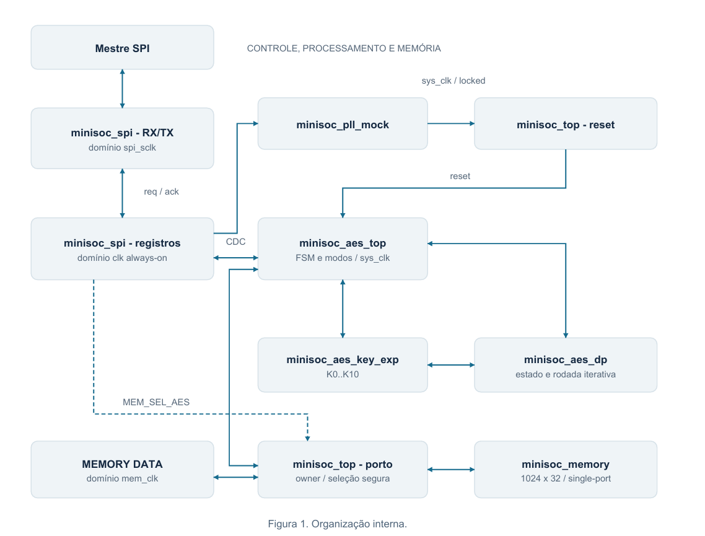
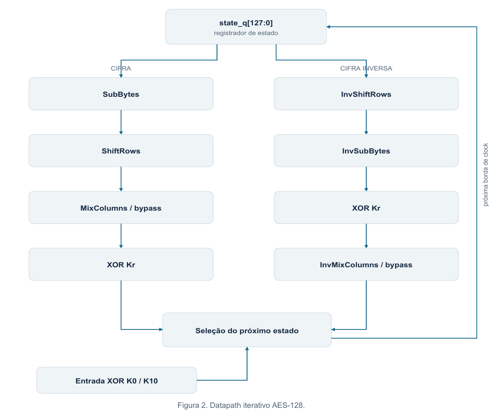
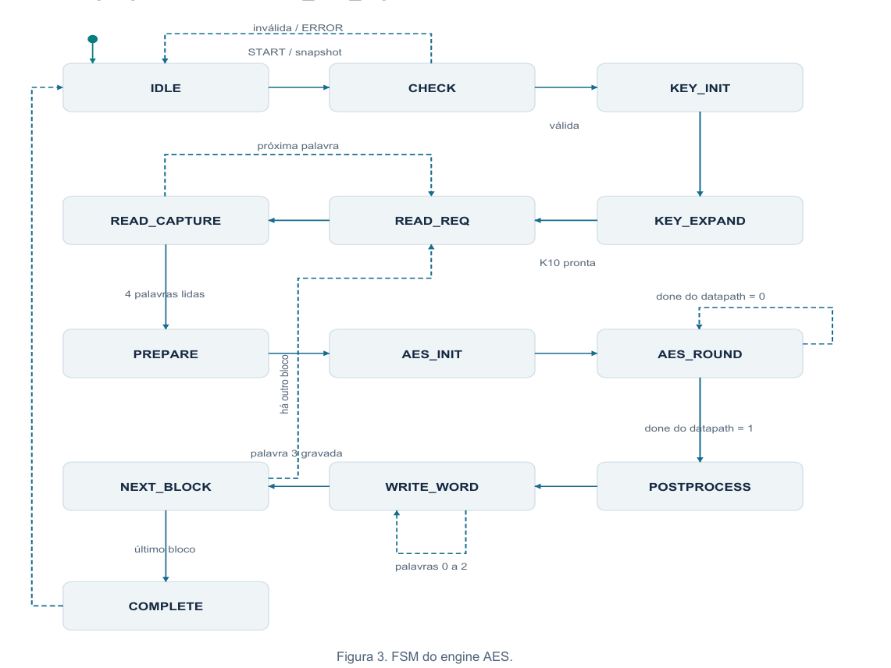

# MiniSoC AES — Microarquitetura v1.0

## 1. Organização interna

`minisoc_top.sv` conectará os blocos, reset e seleção do porto. Permanecem
exatamente as portas externas da seção 3: `clk`, `rst_n`, `spi_sclk`,
`spi_cs_n`, `spi_mosi`, `spi_miso`, `mem_clk`, `mem_i_data[31:0]`,
`mem_i_wr_en`, `mem_i_addr[9:0]` e `mem_o_data[31:0]`.

| Arquivo futuro, sob `rtl/` | Responsabilidade e armazenamento proposto |
| --- | --- |
| `minisoc_spi/minisoc_spi.sv` | RX/TX de 40 bits, contador serial de 6 bits, mailboxes e banco de configuração/status |
| `minisoc_aes/minisoc_aes_top.sv` | Snapshot da operação, FSM, acesso por palavras e lógica dos seis modos |
| `minisoc_aes/minisoc_aes_dp.sv` | `state_q[127:0]`, contador de rodada de 4 bits, caminhos direto/inverso |
| `minisoc_aes/minisoc_aes_key_exp.sv` | Expansão AES-128 e onze round keys de 128 bits |
| `minisoc_mem/minisoc_memory.sv` | Memória síncrona de 1024 palavras, leitura com uma borda de latência, sem reset do conteúdo |
| `minisoc_pll/minisoc_pll_mock.sv` | Divisores /1,/2,/4,/8, aquisição pseudoaleatória e bloqueio até locked |

O PLL fornece `sys_clk` ao engine, ao datapath, à expansão e ao porto de memória
quando o AES é proprietário. O reset local `sys_rst_n` alcança esses três
blocos AES; não apaga a memória. `clk` permanece ativo para configurar o SPI/PLL,
e `mem_clk` pertence ao mestre externo, com limite de 200 MHz.

Interfaces **internas propostas para os módulos futuros**, síncronas a
`sys_clk` no lado AES. Os subblocos AES usam reset ativo em zero; a memória
não possui reset funcional:

| Ligação | Contrato |
| --- | --- |
| Engine → expansão | Pulso `start` de um ciclo e `key[127:0]`, aceitos se `busy=0` |
| Expansão → datapath | Banco K0..K10 de 128 bits; o índice de leitura é selecionado pelo datapath |
| Expansão → engine | `busy` durante a geração; `done` de um ciclo após registrar K10; banco estável até outro start/reset |
| Engine → datapath | Pulso `start`, `block_in[127:0]` e `decrypt_primitive`, capturados se `busy=0` e chaves prontas |
| Datapath → engine | `busy`, pulso `done` e `result[127:0]`, mantido até outro start/reset |
| Engine ↔ memória | Endereço de 10 bits, dado de escrita/leitura de 32 bits e habilitação de escrita; seleção exclusiva do porto |

O `done` de expansão/datapath é um pulso interno. `AES_STATUS.DONE` é um
registro persistente do engine, publicado ao SPI. O pulso START que atravessa
domínios é reconstruído pelo protocolo da seção 5.

## 2. Datapath iterativo AES-128

Escolha: **uma rodada por ciclo**, com estado de 128 bits registrado, 16 S-boxes
por SubBytes e quatro colunas em paralelo. Reutiliza-se a rodada por dez passos,
reduzindo replicação em relação a dez rodadas desenroladas. Caminhos direto e
inverso separados simplificam controle e verificação nesta versão.

| Fase | Cifra | Cifra inversa convencional |
| --- | --- | --- |
| Inicialização | Entrada XOR K0 | Entrada XOR K10 |
| Passos 1–9 | SubBytes → ShiftRows → MixColumns → XOR K1..K9 | InvShiftRows → InvSubBytes → XOR K9..K1 → InvMixColumns |
| Passo 10 | SubBytes → ShiftRows → XOR K10 | InvShiftRows → InvSubBytes → XOR K0 |

A última rodada desvia MixColumns/InvMixColumns. AddRoundKey é XOR e serve
às duas direções. A inversa usa chaves **sem transformação**, na ordem reversa;
não é Equivalent Inverse Cipher. São 11 atualizações de estado por bloco após
a chave pronta, sem contar memória, expansão, modos e handshake do controlador.

O datapath será o único responsável pelo contador de rodada: na borda que
aceita `start`, registra o AddRoundKey inicial; nas dez bordas seguintes,
registra as rodadas 1..10. O índice da chave é r na cifra e 10-r na inversa.
Após a décima rodada, `result` contém o estado final, `done=1` por um ciclo
e `busy=0`. O controlador consome esses sinais na borda seguinte. A FSM do
engine apenas inicia e espera esse processamento, sem duplicar o contador.

A expansão proposta registra K0 e calcula K1..K10 em dez ciclos por operação,
com RotWord, SubWord e Rcon. O banco ocupa 1.408 bits e permite começar a
decriptação por K10 sem expandir novamente a cada bloco. Esse RTL é futuro;
o testbench desta semana fornece round keys constantes.

**Convenção:** byte `n = state[127-8*n -: 8] = s[n%4][n/4]`.
Cada palavra de 32 bits é uma coluna; Word 0 é `[127:96]`.
MixColumns usa GF(2⁸), polinômio `0x11b`. InvMixColumns aplica
`04*(a0 XOR a2)` às linhas pares e `04*(a1 XOR a3)` às ímpares, por XOR,
seguido de MixColumns. Os testes usam os valores intermediários fixos da FIPS-197.
Os nove módulos entregues são combinacionais, sem clock/reset/armazenamento.

| RTL já existente em `rtl/minisoc_aes/` | Interface e relação com o datapath |
| --- | --- |
| `minisoc_aes_sbox.sv` / `minisoc_aes_inv_sbox.sv` | `i_byte[7:0]` → `o_byte[7:0]`; usados por SubBytes/InvSubBytes |
| `minisoc_aes_sub_bytes.sv` / `minisoc_aes_inv_sub_bytes.sv` | `i_state[127:0]` → `o_state[127:0]`; 16 substituições em paralelo |
| `minisoc_aes_shift_rows.sv` / `minisoc_aes_inv_shift_rows.sv` | Mesma interface de estado; permutação fixa dos bytes |
| `minisoc_aes_mix_columns.sv` / `minisoc_aes_inv_mix_columns.sv` | Mesma interface de estado; quatro colunas em paralelo; a inversa instancia MixColumns |
| `minisoc_aes_add_round_key.sv` | `i_state[127:0]`, `i_round_key[127:0]` → `o_state[127:0]` por XOR |

Os sinais sequenciais descritos acima pertencerão aos módulos futuros de
controle/datapath. Não são portas dos nove módulos combinacionais entregues.

A S-box algébrica forma um caminho longo. **Uma rodada/ciclo é uma decisão
funcional, não timing comprovado**: nem 250 MHz nem 2 GHz foram demonstrados.
Síntese futura poderá exigir S-box otimizada ou subdivisão das rodadas,
com revisão da latência. Não há resultados de área, potência ou timing.

## 3. FSM proposta de `minisoc_aes_top`

Ao aceitar a solicitação, o engine captura KEY, IV, COUNTER, MODE, DECRYPT e
NUM_BLOCKS do snapshot recebido do SPI. CHECK valida
MODE 0..5 e NUM_BLOCKS 1..256 **antes de truncar** o registrador SPI de 32 bits
para 9 bits. Escritas SPI posteriores não alteram a operação. Processar requer
PLL liberado, reset concluído e confirmação interna de owner efetivo AES.
Enquanto CHECK estiver ativo, não se aceita uma segunda solicitação.

| Estado/grupo | Ação nas bordas de `sys_clk` |
| --- | --- |
| IDLE/CHECK | Receber snapshot, rejeitar configuração inválida sem acesso à memória; BUSY na aceitação válida |
| KEY_INIT/KEY_EXPAND | Emitir start de expansão por um ciclo e esperar done; a expansão registra K0 e gera K1..K10 |
| READ_REQ/READ_CAPTURE | Apresentar endereço durante READ_REQ, emitir leitura na borda que o encerra e capturar o retorno na borda que encerra READ_CAPTURE |
| PREPARE | Preservar bloco original e aplicar XOR/seleção de entrada do modo |
| AES_INIT/AES_ROUND | Emitir start do datapath por um ciclo e esperar done; o datapath faz inicialização e dez rodadas |
| POSTPROCESS | Produzir resultado e próximo chaining/contador |
| WRITE_WORD | Uma escrita por borda, Word 0..3, nos endereços originais |
| NEXT_BLOCK | Calcular `next_done = blocks_done + 9'd1`, registrá-lo e comparar esse novo valor com NUM_BLOCKS |
| COMPLETE | Desativar BUSY, tornar DONE sticky e publicar status |

`block_index[7:0]` representa 0..255; `word_index[1:0]`, 0..3. O endereço é
`{block_index, word_index}`. `blocks_done[8:0]` e `num_blocks[8:0]` representam
inclusive 256. Comparar a contagem concluída antes de incrementar o índice do
último bloco: se `next_done == num_blocks`, manter o índice e concluir; caso
contrário, incrementá-lo. Reiniciar `word_index=0` antes de ler e antes de
escrever cada bloco. Manter endereço de leitura até capturar o retorno e
avançar a palavra somente depois dessa captura. A memória registra o dado
na borda de READ_REQ; capturá-lo nessa mesma borda usaria o valor anterior.

A habilitação de escrita é 1 apenas em WRITE_WORD, com reset liberado e
owner AES confirmado. Nas demais fases, permanece 0. Reset aborta o controle
e desativa escritas, preservando a memória, inclusive blocos já gravados e
eventual bloco parcialmente escrito.

Políticas propostas para validar: START durante BUSY é ignorado; START inválido
em IDLE seta ERROR e preserva DONE/BLOCKS_DONE anteriores; START válido limpa
ERROR, DONE e BLOCKS_DONE. O caráter sticky de DONE até START válido é do guia.
`BUSY`, `DONE`, `ERROR`, `BLOCKS_DONE` e os índices iniciam em zero no reset.
O pulso interno `done` do datapath não encerra a operação: o engine só afirma
DONE depois de gravar os quatro words do último bloco.

## 4. Modos e preservação in-place

Defina E/D como AES direto/inverso, P como plaintext, C como ciphertext e H como
chaining, inicialmente IV. O controlador conserva `input_q[127:0]`,
`output_q[127:0]`, `chain_q[127:0]` e `counter_q[63:0]`.

| Modo | Cifra | Decriptação | Próximo estado |
| --- | --- | --- | --- |
| ECB | C = E(P) | P = D(C) | Sem chaining |
| CBC | C = E(P XOR H) | P = D(C) XOR H | H = C |
| PCBC | C = E(P XOR H) | P = D(C) XOR H | H = P XOR C |
| CFB-128, proposta | C = P XOR E(H) | P = C XOR E(H) | H = C |
| OFB | C = P XOR E(H) | P = C XOR E(H) | H = E(H) |
| CTR | C = P XOR E(IV XOR zero_extend(counter)) | P = C XOR E(IV XOR zero_extend(counter)) | counter = counter + 1 |

ECB/CBC/PCBC usam D se DECRYPT=1. CFB usa sempre E, mas DECRYPT determina qual
ciphertext guardar. OFB/CTR usam E nas duas direções. Em CBC/CFB decriptação,
preservar C de entrada antes da escrita; em PCBC, preservar entrada e saída.
CTR propõe soma módulo 2⁶⁴ interna, sem writeback automático ao banco SPI.
O guia fixa **IV XOR contador zero-extendido**, não concatenação.
CFB-128, overflow e writeback do contador precisam de confirmação: o guia
não detalha esses comportamentos.

## 5. SPI e CDC por toggle

O banco fica em **clk always-on de 2 GHz**, independente do PLL. RX/TX fica em
`spi_sclk`, até 25 MHz. Preservar Mode 0, MSB-first, MOSI na subida e MISO na
descida. Frame: `{RWb[39], ADDR[38:33], RSV[32], DATA[31:0]}`, RSV=0.
Write ocupa uma transação; Read usa seleção e outra transação de retorno com
NOP (`0x3f`). Confirmar alinhamento do retorno com o verificador, pois a
seção 5.2 não detalha os bits de resposta.

**Mailbox de frame, spi_sclk → clk:**

1. Na 40ª subida, registrar o frame completo incluindo o último MOSI em
   `frame_hold[39:0]` e inverter `req_toggle`.
2. Sincronizar o toggle por dois flip-flops em clk e comparar o segundo
   estágio com `req_seen` para detectar uma transferência.
3. Marcar uma captura pendente, capturar o payload estável numa borda adicional
   e executar a transação uma vez; não detectar novamente o mesmo toggle enquanto captura.
4. Atualizar `req_seen`, devolver `ack_toggle` e sincronizá-lo por dois estágios
   em spi_sclk. Manter `frame_hold` intacto até observar esse ack.

O shift register é separado do mailbox para receber outro frame durante o ack.
Se SCLK parar, o ack persistente será observado nas novas bordas. A 25 MHz,
um frame dura 1,6 µs; o tratamento em clk leva poucos ns. As bordas do próximo
frame permitem observar ack antes do próximo commit. O RTL deverá checar
mailbox ocupado no commit, sem sobrescrita silenciosa.
CS aborta frames incompletos, mas **não zera toggle/mailbox de frame publicado**.
Os dois lados só reinicializam o protocolo em reset coordenado.

O payload não recebe sincronizadores independentes por bit: permanece estável
entre req e ack, com assentamento antes da captura. Exige constraints de
bundled-data e revisão de CDC física; sincronizar só o evento não comprova
coerência do barramento. Para Read, clk publica snapshot de 32 bits e toggle
de resposta, mantendo-o até ack serial. O serial confirma a cópia para seu
registrador local e mantém o dado estável durante o deslocamento. O instante
de carga e a posição do primeiro bit de resposta dependem do alinhamento
de retorno ainda a confirmar; não se deve pressupor um cabeçalho de oito
bits na resposta apenas porque o comando possui esse cabeçalho.

**clk ↔ sys_clk:** START publica snapshot único, mantido até ack do AES.
Na escrita de AES_CONTROL com START=1, MODE e DECRYPT do snapshot são os
da **mesma escrita**, e não os valores anteriores do banco SPI. Os demais
campos vêm da configuração já armazenada. A origem mantém uma indicação
interna de comando pendente até ack e não sobrescreve esse snapshot.
O ack confirma a recepção, não a conclusão da operação; o engine continua
rejeitando START durante CHECK/BUSY. O estado BUSY refletido no SPI possui
latência de CDC e não deve ser a única proteção contra um segundo START.

O destino produz pulso local e captura o snapshot uma vez, após `sys_ready`.
Comando após PLL_LOCKED, mas durante liberação de reset, permanece pendente:
o banco always-on retém a solicitação e só publica o toggle quando o reset
local da origem do bridge estiver liberado.
Com PLL desabilitado/sem lock, a proposta é descartar START, sem enfileirá-lo
para execução futura. Se a transferência de owner ainda não terminou,
aguardar a confirmação interna antes de aceitar o comando no engine.
Se MEM_SEL_AES=0 e não há solicitação de transferência para AES, a proposta
também é descartar START, sem acessos à memória.
BUSY/DONE/ERROR/BLOCKS_DONE retornam juntos por mailbox; a amostra fica estável
até ack, e mudanças posteriores ficam pendentes para nova publicação.
O banco SPI conserva a última amostra coerente. PLL_LOCKED/prontidão são
sincronizados como sinais de um bit em clk.

## 6. Reset do sistema e ownership

Sequência proposta para atender à seção 4.2:

1. `rst_n=0` afirma resets assincronamente; PLL_ENABLE e ownership voltam a zero.
   A memória não é apagada.
2. `rst_n=1` libera o controle após dois estágios em clk. SPI configura o PLL
   com AES ainda parado/em reset.
3. Habilitar PLL com divisor estável; liberar sys_clk somente após locked.
4. Formar `sys_release_n = rst_n & PLL_ENABLE & locked`. Seu nível zero
   afirma assincronamente o reset e zera o pipeline de liberação.
5. Após **duas bordas válidas de sys_clk**, liberar `sys_rst_n`. A primeira
   atualização funcional ocorre na borda seguinte. Sincronizar `sys_ready`
   de volta ao domínio de controle.
6. Reset global, disable ou perda de lock reafirmam reset mesmo sem clock.
   Reinicializar coordenadamente os mailboxes clk↔sys_clk, descartando
   comandos/respostas da sessão anterior para evitar eventos falsos.

Os dois lados do bridge têm reset assíncrono pela mesma condição
`sys_release_n=0` e liberação sincronizada nos respectivos clocks. Toggles,
sincronizadores, confirmações e marcações de evento consumido começam em zero.
`sys_ready=0` por si só **não limpa** o comando da origem: durante a liberação
normal, ele apenas impede o consumo no destino. Isso preserva um START que
chegue após locked e antes da conclusão dos dois estágios de reset.

Perda de clock aborta o engine; nova operação requer nova prontidão/START.
Fechar com o verificador o status de aborto; não presumir rollback da memória.
Reset serial e CS são distintos: detalhar recovery/removal e liberação local
ao implementar SPI, sem dependência de sys_clk.

Ownership só troca com AES ocioso e sem operação externa em andamento
(seção 7.2). Sem ready/valid em MEMORY DATA, o mestre externo deve ficar
quiescente durante a troca. Usar seleção de clock segura, bloquear escritas
na transição e confirmar owner internamente antes de START. Mux combinacional
comum entre mem_clk/sys_clk pode gerar bordas falsas e não é solução válida.
Para a integração, propõe-se que o mestre pare `mem_clk` em nível baixo após
a última operação e o mantenha assim durante a troca. O mecanismo não pode
depender de novas bordas de mem_clk para concluir a transferência. A FSM usa
a confirmação de owner efetivo, não somente o bit de solicitação vindo do SPI.
A forma de o mestre reconhecer o fim da troca, sem acrescentar portas ou
registradores ao guia, ainda precisa ser acordada com o verificador.
Alterações de PLL ou owner durante BUSY estão fora da sequência normal; definir a política
defensiva na integração.

## 7. Registradores preservados

| Endereço | Registro | Campos relevantes |
| --- | --- | --- |
| 0x00–0x03 | KEY0..KEY3 | KEY[127:96] até KEY[31:0] |
| 0x04–0x07 | IV0..IV3 | IV[127:96] até IV[31:0] |
| 0x08–0x09 | COUNTER_HI/LO | COUNTER[63:32] e [31:0] |
| 0x0A | NUM_BLOCKS | Validar 32 bits, faixa 1..256 |
| 0x0B | AES_CONTROL | MODE[4:2], DECRYPT[1], START[0] write-one-pulse |
| 0x0C | AES_STATUS | BLOCKS_DONE[11:3], ERROR[2], DONE[1], BUSY[0] |
| 0x0D | VERSION | Valor a confirmar |
| 0x0E | SYSTEM_CONTROL | PLL_DIV_SEL[3:2], PLL_ENABLE[1], MEM_SEL_AES[0] |
| 0x0F | SYSTEM_STATUS | PLL_LOCKED[0] |
| 0x3F | NOP | Fase de retorno de leitura |
