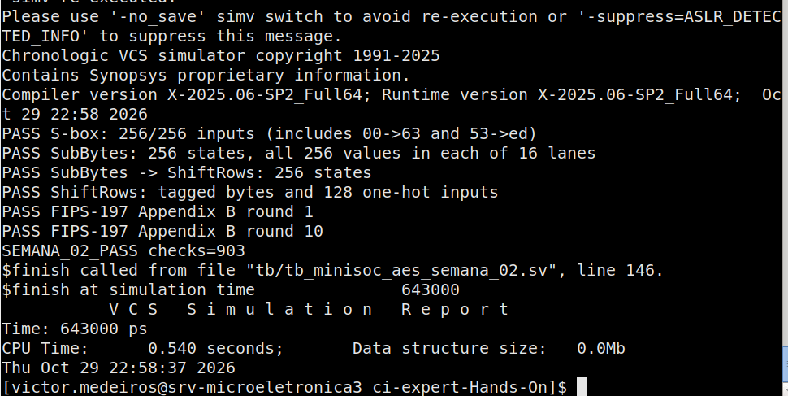

# Semana 2 — SubBytes e ShiftRows

**Referência:** Block Guide MiniSoC AES v1.0.0, seções 1–3 e 8.
**Entrega prevista:** 30/10/2026.
**Execução dos testes:** 29/10/2026.
**Finalização do relatório:** 02/11/2026.
**Situação:** simulação executada manualmente pelo responsável pelo projeto,
com **PASS nas 903 verificações**. A saída completa confirma lint executado
sem erros reportados, com seis avisos `Lint-[NS]` de esperas intencionais no
testbench. Nenhuma mensagem de lint foi reportada nos três módulos RTL.

## Implementação

| Arquivo em `rtl/minisoc_aes/` | Interface | Implementação |
| --- | --- | --- |
| `minisoc_aes_sbox.sv` | `i_byte[7:0]` → `o_byte[7:0]` | Inversa em GF(2⁸), seguida da transformação afim AES |
| `minisoc_aes_sub_bytes.sv` | `i_state[127:0]` → `o_state[127:0]` | 16 instâncias independentes da S-box |
| `minisoc_aes_shift_rows.sv` | `i_state[127:0]` → `o_state[127:0]` | Concatenação de fatias de bytes; somente fios |

Os três módulos são combinacionais, sem clock, reset, registradores ou handshake.
A S-box usa o polinômio `0x11b`, calcula `a^254` para a inversão (zero permanece
zero nesta etapa) e aplica a transformação afim com constante `0x63`.
A referência do testbench é uma tabela fixa de 256 bytes da FIPS-197, independente
do cálculo algébrico usado no RTL.

A implementação algébrica prioriza uma descrição direta e verificável.
Área, atraso e adequação aos clocks do MiniSoC ainda não foram avaliados.

## Convenção de estado

O byte `n` ocupa `[127 - 8*n -: 8]` e representa `s[r][c]`, com `r=n%4` e
`c=n/4`. O byte 0 é `[127:120]`, o byte 15 é `[7:0]`, e Word 0 é `[127:96]`.
Esta última relação também foi conferida na seção 7.1 do guia.

ShiftRows aplica `s_out[r][c] = s_in[r][(c+r)%4]`. Os índices de entrada,
na ordem dos bytes de saída, são:

```text
0, 5, 10, 15, 4, 9, 14, 3, 8, 13, 2, 7, 12, 1, 6, 11
```

## Testbench e resultados dos testes

Arquivo: `tb/tb_minisoc_aes_semana_02.sv`. Comparações usam `!==` e falhas
terminam com `$fatal(1, ...)`; há um watchdog de 10 µs. Os atrasos `#1`
existem somente no testbench, para acomodar a propagação combinacional.

| Verificação | Comparações | Resultado |
| --- | ---: | --- |
| S-box, entradas `00` a `ff`, incluindo `00→63` e `53→ed` | 256 | PASS |
| SubBytes, 256 estados; todos os valores nas 16 posições | 256 | PASS |
| Cadeia SubBytes → ShiftRows nos mesmos 256 estados | 256 | PASS |
| ShiftRows com bytes identificados e 128 padrões de um único bit em 1 | 129 | PASS |
| Rodadas 1 e 10: SubBytes, ShiftRows isolado e cadeia | 6 | PASS |
| **Total funcional** | **903** | **PASS** |
| Lint dos três módulos RTL | — | Sem erros ou avisos reportados |
| Lint do testbench | — | Sem erros; seis avisos `Lint-[NS]` analisados |

Para isolar erros, o ShiftRows recebe também o estado publicado após SubBytes,
sem depender da saída calculada pelo DUT. Os vetores abaixo vêm do Apêndice B
da FIPS-197 (2001), páginas impressas 33–34, serializados por colunas:

```text
Rodada 1
Start of Round : 193de3bea0f4e22b9ac68d2ae9f84808
After SubBytes : d42711aee0bf98f1b8b45de51e415230
After ShiftRows: d4bf5d30e0b452aeb84111f11e2798e5

Rodada 10
Start of Round : eb40f21e592e38848ba113e71bc342d2
After SubBytes : e9098972cb31075f3d327d94af2e2cb5
After ShiftRows: e9317db5cb322c723d2e895faf090794
```

Não se verifica aqui uma cifra completa: MixColumns, AddRoundKey, expansão de
chave, controle das dez rodadas e modos de operação pertencem às próximas etapas.

## Evidência da execução manual

Resultado de `make run` informado pelo responsável pelo projeto e documentado
pela [saída completa do terminal](semana_02/make_run.txt) e pela captura abaixo.
A execução não foi repetida para elaborar este relatório.

- **Data/hora exibida no terminal:** 29/10/2026, 22:58:37 (fuso não indicado).
- **Simulador:** Synopsys VCS; compilador e runtime `X-2025.06-SP2_Full64`.
- **Resultado:** `SEMANA_02_PASS checks=903`.
- **Término:** `$finish`, chamado pelo testbench na linha 146 da versão executada.
- **Tempo simulado:** 643000 ps, equivalente a 643 ns.
- **Tempo de CPU informado pelo VCS:** 0,540 s.



A captura confirma PASS na S-box, no SubBytes, na cadeia SubBytes → ShiftRows,
na permutação de bytes e bits do ShiftRows e nas rodadas 1 e 10 da FIPS-197.
Não há falha de teste reportada. A saída completa também registra a análise
dos quatro arquivos, a elaboração de `tb_minisoc_aes_semana_02`, a geração
do executável e a execução de `./simv` até o retorno ao prompt.

Trecho de conclusão da simulação:

```text
PASS S-box: 256/256 inputs (includes 00->63 and 53->ed)
PASS SubBytes: 256 states, all 256 values in each of 16 lanes
PASS SubBytes -> ShiftRows: 256 states
PASS ShiftRows: tagged bytes and 128 one-hot inputs
PASS FIPS-197 Appendix B round 1
PASS FIPS-197 Appendix B round 10
SEMANA_02_PASS checks=903
```

## Análise do lint

O comando registrado na saída completa foi:

```sh
vlogan -full64 -sverilog -kdb +lint=all \
  rtl/minisoc_aes/minisoc_aes_sbox.sv \
  rtl/minisoc_aes/minisoc_aes_sub_bytes.sv \
  rtl/minisoc_aes/minisoc_aes_shift_rows.sv \
  tb/tb_minisoc_aes_semana_02.sv
```

Foram reportadas seis ocorrências de `Lint-[NS] Null statement`, todas no
arquivo `tb/tb_minisoc_aes_semana_02.sv`. As linhas abaixo correspondem à
versão executada no servidor:

| Linhas | Comando | Ocorrências | Análise |
| --- | --- | ---: | --- |
| 80, 95, 111, 120 e 126 | `#1;` | 5 | Espera de 1 ns para acomodar a propagação combinacional antes das comparações |
| 150 | `#10000;` | 1 | Espera de 10 µs do watchdog; encerra com erro se o teste não terminar antes |

O aviso identifica o comando vazio após o controle de atraso. Os atrasos
são intencionais e pertencem apenas ao testbench; não representam lógica
sequencial no RTL nem divergência funcional. Foram mantidos e registrados
como avisos justificados, sem desabilitar `+lint=all`.

Não aparecem erros de análise, compilação ou elaboração na saída fornecida.
O fluxo prosseguiu para VCS e simulação. Portanto, o resultado é **lint sem
erros reportados, com seis avisos analisados no testbench**, e não ausência
total de mensagens de lint.

A mensagem `VCS_SAVE_RESTORE_INFO` sobre ASLR é informativa do simulador,
separada das ocorrências de lint. A execução continuou e concluiu os testes.

## Execução manual e aceite

Na raiz do repositório, com GNU Make, VCS e vlogan disponíveis no PATH:

```sh
make run
```

O Makefile mantém o fluxo original: `syntax` chama `vlogan +lint=all`,
`compile` depende de `syntax` e chama VCS, e `run` depende de `compile` e
executa `./simv`. Para apenas análise de sintaxe e lint, usar `make syntax`.
Os fontes são listados explicitamente e as saídas de simulação ficam na raiz.

| Critério da Semana 2 | Evidência | Resultado |
| --- | --- | --- |
| Testbench executado por um único comando | `make run` executou análise, elaboração e simulação | Atendido |
| S-box comparada com a tabela nas 256 entradas | `PASS S-box: 256/256 inputs` | Atendido |
| SubBytes e ShiftRows nas rodadas 1 e 10 | Mensagens PASS para ambas as rodadas e `SEMANA_02_PASS checks=903` | Atendido |
| Lint sem erros | Análise com `+lint=all`, sem erros reportados e seis avisos de espera justificados | Atendido |
| Leitura das seções 1–3 e 8 e registro de dúvidas | Seção de leitura e questões deste relatório | Atendido |

**Conclusão:** as atividades da Semana 2 foram concluídas, com 903 verificações
funcionais aprovadas e lint sem erros reportados. Os seis avisos do testbench
foram analisados e justificados. O código numérico de saída não foi impresso
no terminal; a evidência registra a conclusão por `$finish`, o marcador PASS
e o retorno ao prompt sem erro do Make. O `^C` aparece após esse retorno,
não durante a simulação.

Os resultados se limitam aos três módulos combinacionais e ao testbench da
Semana 2. Área, potência, timing e integração do MiniSoC não foram validados
por esta execução. Os relatórios de síntese dependem de `make synth` e não
fazem parte da evidência apresentada.

## Leitura do Block Guide e questões para esclarecer

| Seção | Entendimento e impacto nesta etapa |
| --- | --- |
| 1 — Visão geral | AES-128 com blocos/chave de 128 bits, seis modos e até 256 blocos. Os submódulos desta semana serão reutilizados em `minisoc_aes_dp`. |
| 2 — Arquitetura | SPI configura o sistema; AES processa a memória in-place. O controle SPI usa a referência always-on. As transformações desta entrega são independentes desse controle. |
| 3 — Interfaces | O topo expõe CLK, RESET, SPI e MEMORY DATA. As portas de estado desta semana são internas, não novas interfaces externas do MiniSoC. |
| 8 — AES Engine | O datapath deve suportar dez rodadas e cifra/inversa; START captura a configuração. BUSY, DONE, ERROR e BLOCKS_DONE serão responsabilidade do engine, não destes módulos combinacionais. |

Questões registradas para a integração, sem bloquear as transformações desta semana:

1. **Seções 1.3 e 8.1:** quais nomes de portas e limites de registro serão adotados
   no datapath? O guia identifica os módulos, mas não fixa essas interfaces internas.
   Nesta entrega foram adotados `i_byte/o_byte` e `i_state/o_state`.
2. **Seções 2 e 3:** como serão sincronizadas as transferências de configuração,
   status e ownership entre os domínios de clock? Qual sequência garante a troca
   segura quando a interface MEMORY DATA não expõe `ready/valid`?
3. **Seção 8.1:** qual será a latência e a organização das rodadas (iterativa,
   pipeline ou outra)? Quais metas de área e frequência orientarão a S-box?
4. **Seção 8.2:** qual tamanho de segmento CFB deve ser implementado? Quais são
   as equações exatas de atualização de chaining para PCBC e CFB em decriptação?
5. **Seção 8.2:** no CTR, qual é a política de overflow do contador de 64 bits?
   O valor atualizado é apenas interno ou deve ser exposto após a operação?
   A formação especificada `IV XOR zero_extend(COUNTER)` deve ser preservada.
6. **Seções 8.3 e 8.4:** qual é o comportamento de START enquanto BUSY está ativo?
   Como ERROR e BLOCKS_DONE são limpos ou atualizados em START inválido, reset
   e nova operação? A descrição explicita o caráter sticky de DONE, mas não
   detalha todas essas transições.

## Referências

- [Block Guide MiniSoC AES v1.0.0](Resumos/DV_BlockGuide_MiniSoCAES_v1.0.0.pdf),
  seções 1–3 e 8; consulta pontual à seção 7.1 para a ordem das palavras.
- [NIST FIPS-197 (2001)](https://nvlpubs.nist.gov/nistpubs/FIPS/NIST.FIPS.197.pdf),
  seção 3.4, Figura 7, seções 5.1.1–5.1.2 e Apêndice B. A edição de 2001 é
  usada para corresponder à numeração do enunciado; a revisão editorial de
  2023 não alterou o algoritmo AES.
