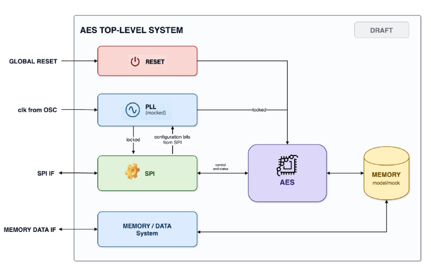
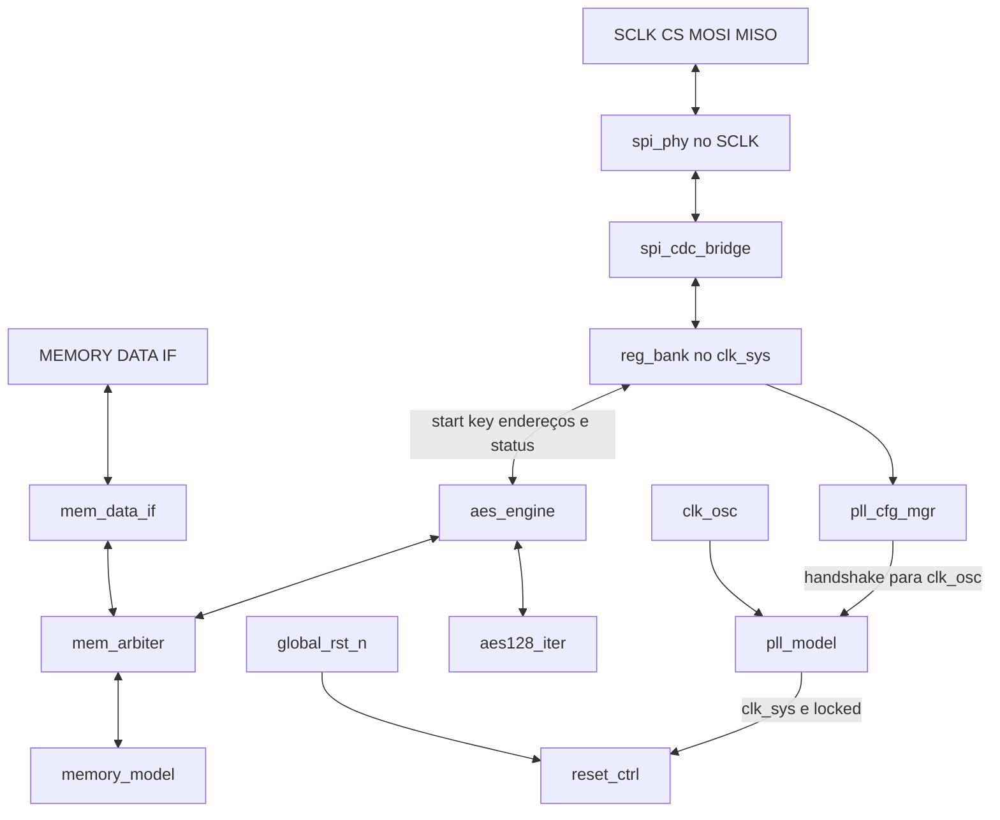
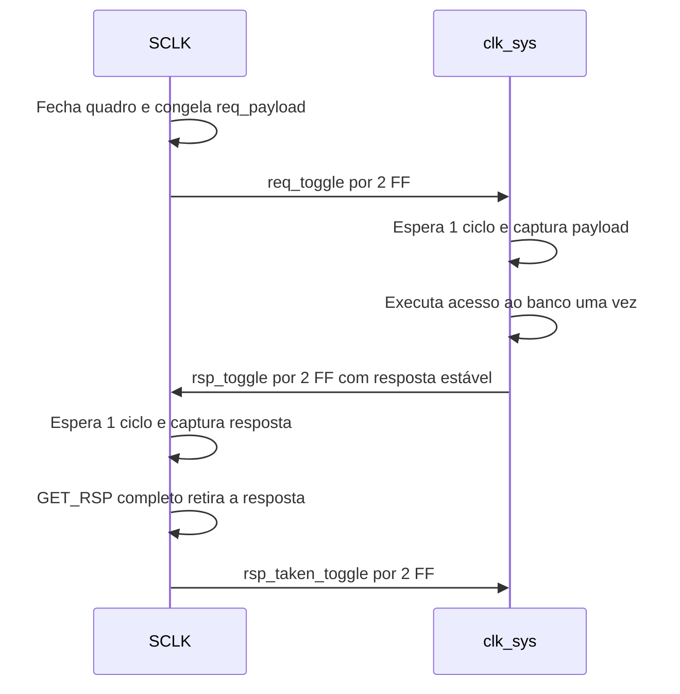
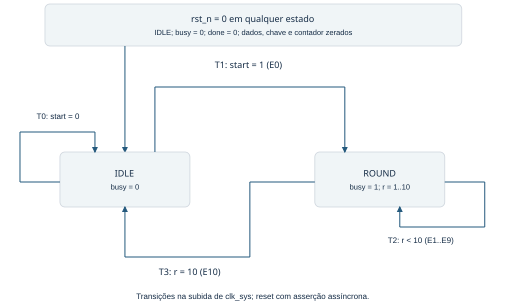

# Arquitetura do AES Top Level System

Semana 2 | Documento de arquitetura v1.0 | Entregável técnico

Este documento define os blocos, as interfaces, os registradores, os domínios de clock e reset, os modelos comportamentais e o núcleo AES do sistema. A microarquitetura escolhida é **AES-128 iterativa por rodada**, com uma única unidade de rodada reutilizada ao longo das dez rodadas e processamento de uma rodada por ciclo.

## 1 Diagrama de blocos e interfaces internas

### 1.1 Arquitetura de topo de referência



**Figura 1.** Arquitetura-base fornecida para o projeto, comum às trilhas RTL e Design Verification. Recorte da figura enviada nesta revisão, sem alteração dos blocos ou das conexões.

O sistema preserva RESET, PLL mockado, SPI, AES, MEMORY e MEMORY / DATA System, além das interfaces GLOBAL RESET, clk from OSC, SPI IF e MEMORY DATA IF. O SPI configura e controla o processamento; a interface de dados movimenta os blocos por meio da memória. O detalhamento da seção 1.2 desdobra esses blocos em módulos RTL e modelos.

**Escopo da versão.** Cifragem AES-128, bloco de 128 bits, um bloco por comando, SPI modo 0 e memória de 4 KiB com palavras de 32 bits. A definição do AES segue a FIPS 197. Decifragem e AES-192/256 não integram esta versão.

**Situação do contrato.** O diagrama de topo é a referência estrutural. As larguras, o protocolo SPI, o mapa e as assinaturas dos modelos são definições propostas nesta v1.0; a compatibilidade com os modelos da trilha depende da confirmação de suas interfaces pelo verificador.

<!-- page -->

### 1.2 Decomposição em módulos e interfaces internas



**Figura 2.** Detalhamento da arquitetura-base. SCLK e clk_sys são os domínios funcionais; clk_osc é a referência do PLL. Clock e reset são distribuídos conforme a seção 4.

| Bloco da referência | Módulos propostos | Função preservada |
| --- | --- | --- |
| RESET | reset_ctrl | Inicializa os domínios e qualifica a liberação com locked |
| PLL mockado | pll_model | Gera clk_sys e locked a partir de clk_osc |
| SPI | spi_phy, spi_cdc_bridge, reg_bank e pll_cfg_mgr | Recebe comandos, mantém configuração e retorna status |
| AES | aes_engine e aes128_iter | Movimenta os blocos e executa as rodadas AES |
| MEMORY | memory_model | Armazena entrada e resultado em porta única |
| MEMORY / DATA System | mem_data_if e mem_arbiter | Liga os dados externos à memória e arbitra com o AES |

**Canais internos.** PHY e banco trocam pedidos de 49 bits e respostas de 40 bits pela ponte CDC da seção 4.1. O banco entrega start, key[127:0], src_addr[11:0] e dst_addr[11:0] ao AES e recebe busy, done, error e error_code[1:0], conforme a seção 7. Os clientes da RAM compartilham o canal req/rsp de 32 bits da seção 5.2. O gerenciador configura o PLL pelo handshake da seção 5.1.

O módulo aes_top reúne esses blocos. A divisão interna do bloco SPI mantém seu PHY no SCLK e leva o banco e o controle do AES ao clk_sys. O árbitro implementa o compartilhamento já indicado pelas duas conexões da memória no diagrama-base.

<!-- page -->

## 2 Interfaces de topo

Todas as direções abaixo são vistas pelo módulo aes_top. O sufixo _n indica ativo em zero; larguras omitidas em diagramas não alteram as larguras destas tabelas.

| Interface | Porta | Dir. | Bits | Contrato |
| --- | --- | --- | --- | --- |
| GLOBAL RESET | global_rst_n | I | 1 | Reset externo assíncrono, ativo em zero |
| clk from OSC | clk_osc | I | 1 | Referência contínua do PLL e de seu controle |
| SPI IF | spi_sclk | I | 1 | Clock independente, repouso em zero |
| SPI IF | spi_cs_n | I | 1 | Seleção e delimitação de quadro, ativa em zero |
| SPI IF | spi_mosi | I | 1 | Capturada em cada subida do SCLK selecionado |
| SPI IF | spi_miso | O | 1 | Atualizada nas descidas; alta impedância fora de seleção |
| MEMORY DATA IF | mem_clk_o | O | 1 | clk_sys exportado como referência ao controlador externo |
| MEMORY DATA IF | mem_ready_o | O | 1 | Domínio funcional liberado; não substitui req_ready |
| MEMORY DATA IF | mem_req_valid_i | I | 1 | Requisição estável até aceitação |
| MEMORY DATA IF | mem_req_ready_o | O | 1 | Aceita requisição quando também valid = 1 |
| MEMORY DATA IF | mem_req_write_i | I | 1 | 0 leitura; 1 escrita |
| MEMORY DATA IF | mem_req_addr_i | I | 12 | Endereço de byte, alinhado em 4 bytes |
| MEMORY DATA IF | mem_req_wdata_i | I | 32 | Palavra de escrita |
| MEMORY DATA IF | mem_req_wstrb_i | I | 4 | Habilitação dos quatro bytes |
| MEMORY DATA IF | mem_rsp_valid_o | O | 1 | Pulso de um ciclo indicando resposta |
| MEMORY DATA IF | mem_rsp_rdata_o | O | 32 | Dado de leitura; zero para escrita/erro |
| MEMORY DATA IF | mem_rsp_err_o | O | 1 | Erro associado ao ciclo de rsp_valid |

**Clock da interface de dados.** O controlador externo deve usar mem_clk_o e respeitar setup/hold. Não há clock externo de dados independente nesta proposta. Se a trilha exigir outra relação temporal, será necessário acordar um adaptador e sua travessia de domínio antes de integrar. mem_clk_o e mem_ready_o são portas propostas para tornar esse contrato explícito.

**MISO e implementação física.** Internamente, usar miso_o e miso_oe. Apenas o pad/wrapper de topo produz Z quando CS = 1 ou rst_spi_n = 0. Durante reset, nenhuma interface aceita operações. Clock exportado e entrada SCLK precisam de restrições próprias de temporização; frequências máximas físicas serão determinadas na implementação.

<!-- page -->

### 2.1 Protocolo da MEMORY DATA IF

Uma requisição é aceita na subida de mem_clk_o com mem_ready_o, mem_req_valid_i e mem_req_ready_o em 1. Endereço, direção, dado e strobes permanecem estáveis enquanto valid = 1 e ready = 0. Após aceitação, o solicitante pode retirar valid ou apresentar a próxima operação. Há no máximo uma requisição externa pendente.

Cada requisição aceita gera exatamente uma resposta, inclusive escrita ou acesso inválido. rsp_valid dura um ciclo; o controlador deve sempre capturar a resposta, pois não existe rsp_ready. Não se aceita outra requisição no mesmo ciclo da resposta. Durante reset ou perda de locked, requisições pendentes são abortadas, sem promessa de resposta; o controlador reinicia o protocolo quando mem_ready_o voltar.

| Condição | Comportamento |
| --- | --- |
| Endereço válido | 0x000 a 0xFFC, múltiplo de 4 |
| addr[1:0] diferente de zero | Resposta de erro, sem acesso à memória |
| Leitura | wdata e wstrb ignorados; devolve palavra de 32 bits |
| Escrita | wstrb[n] habilita wdata[8*n +: 8]; strobes zero são operação sem efeito |
| AES ocupado ou reservado | req_ready = 0; uma requisição ainda não aceita pode aguardar |
| Nenhum acesso pendente | req_ready pode subir, desde que o AES não esteja reservado |
| Falha da memória | Propagar rsp_err; não apresentar dado como válido |

**Ordenação dos bytes.** O menor endereço contém o byte mais significativo da palavra. Para uma palavra W no endereço A: memória[A] = W[31:24], memória[A+1] = W[23:16], memória[A+2] = W[15:8] e memória[A+3] = W[7:0]. Assim, wstrb[3] seleciona o byte de A e wstrb[0] o de A+3. Essa convenção deve ser reproduzida no driver e no scoreboard.

Um bloco AES usa quatro palavras consecutivas W0, W1, W2 e W3, em endereços crescentes, e é montado como {W0, W1, W2, W3}.

**Arbitragem de START.** START só é aceito se não houver acesso externo pendente. Se START válido e uma nova requisição externa disputarem a mesma borda ociosa, START tem prioridade e req_ready fica em zero nessa borda. Após a aceitação, o AES conserva a reserva até a resposta da última escrita ou até erro. A reserva não depende de SCLK.

**Porta única.** A exclusão mútua simplifica colisões e permite SRC_ADDR = DST_ADDR: as quatro leituras terminam antes da primeira escrita. Um reset durante as escritas pode deixar um resultado parcial; DONE nunca deve indicar conclusão nesse caso.

<!-- page -->

### 2.2 Protocolo SPI

Adota-se modo 0: CPOL = 0, CPHA = 0, bytes MSB primeiro. MOSI é amostrado na subida e MISO muda na descida. O primeiro bit de MISO de todo quadro é zero e deve estar disponível antes da primeira subida. Cada quadro começa com CS em zero e termina com CS em um; SCLK permanece em zero entre quadros.

| Quadro | Bytes MOSI em ordem | Retorno MISO |
| --- | --- | --- |
| READ_REG | 01, ADDR_H, ADDR_L, 00, 00, 00, 00 | Sete bytes zero |
| WRITE_REG | 02, ADDR_H, ADDR_L, D3, D2, D1, D0 | Sete bytes zero |
| GET_RSP | 00, 00, 00, 00, 00, 00 | 00, STATUS, R3, R2, R1, R0 |

Os endereços de registrador têm 16 bits e são endereços de byte. Dados de 32 bits são transmitidos do byte mais significativo ao menos significativo. Não há autoincremento nem burst. READ_REG exige os quatro bytes de preenchimento zero.

**Commit da requisição.** Na 56ª subida de um quadro READ_REG/WRITE_REG válido, o PHY publica a requisição completa na caixa de correio. Um quadro interrompido antes disso não altera registradores. Bordas extras após o tamanho previsto são ignoradas até CS subir. CS alto reinicia somente o parser, nunca a caixa de correio.

**Resposta em quadro separado.** Ao receber o opcode de GET_RSP, o PHY congela uma cópia da resposta disponível. Se ela ainda não chegou, envia STATUS = 0x00 e dados zero; uma resposta que chegar depois fica para o próximo GET_RSP. A resposta congelada é transmitida a partir da descida após a oitava subida. Isso evita mudar o status no meio de um byte.

| STATUS | Significado | RDATA |
| --- | --- | --- |
| 0x00 | Nenhuma resposta disponível; repetir GET_RSP | Zero |
| 0x80 | Operação de registrador concluída | Leitura ou zero em escrita |
| 0x81 | Endereço inexistente ou desalinhado | Zero |
| 0x82 | Acesso proibido, como escrita em RO | Zero |
| 0x83 | Recurso ocupado | Zero |
| 0x84 | Valor ou combinação de bits inválida | Zero |
| 0x85 | Pré-condição ausente, como chave incompleta | Zero |

Uma resposta final só é retirada na 48ª subida de um GET_RSP completo. Se CS subir antes, ela permanece para repetição. O host deve retirar a resposta antes de emitir outra requisição; um novo READ/WRITE enquanto existe pendência é ignorado, preservando a transação anterior. Opcode desconhecido ou preenchimento READ não zero descarta o quadro sem efeito e sem resposta. O host usa timeout para esses erros de enquadramento.

<!-- page -->

## 3 Mapa de registradores

O espaço SPI usa palavras de 32 bits alinhadas em 4 bytes. Endereços não listados geram BAD_ADDR. RO é somente leitura; RW permite leitura e escrita; WO é comando de escrita com leitura zero; W1C limpa bits ao escrever 1. Toda escrita é de palavra completa e é atômica.

| Endereço | Nome | Acesso | Reset | Função |
| --- | --- | --- | --- | --- |
| 0x0000 | ID | RO | 0x41455331 | Identificação ASCII AES1 |
| 0x0004 | VERSION | RO | 0x00010000 | major[31:16] = 1; minor[15:0] = 0 |
| 0x0008 | CAPABILITIES | RO | 0x0000000F | Recursos da v1.0 |
| 0x000C | CONTROL | WO | 0 | START e KEY_CLEAR |
| 0x0010 | STATUS | RO | 0 | Ocupação, conclusão, erro, chave e PLL |
| 0x0014 | STATUS_CLEAR | WO W1C | 0 | Limpa DONE e ERROR |
| 0x0018 | ERROR_CODE | RO | 0 | Último erro de operação AES |
| 0x001C | Reservado | - | - | BAD_ADDR |
| 0x0020 | KEY0 | WO | 0 | key[127:96] |
| 0x0024 | KEY1 | WO | 0 | key[95:64] |
| 0x0028 | KEY2 | WO | 0 | key[63:32] |
| 0x002C | KEY3 | WO | 0 | key[31:0] |
| 0x0030 | KEY_VALID_MASK | RO | 0 | Bits [3:0] indicam palavras carregadas |
| 0x0040 | SRC_ADDR | RW | 0 | Endereço de byte do bloco de entrada |
| 0x0044 | DST_ADDR | RW | 0 | Endereço de byte do bloco de saída |
| 0x0050 | PLL_CFG | RW | 0x00000001 | Shadow de configuração do PLL |
| 0x0054 | PLL_APPLY | WO | 0 | Bit 0 aplica o shadow após retirada da resposta |
| 0x0058 | PLL_ACTIVE | RO | 0x00000001 | Última configuração confirmada pelo modelo |

**Semântica comum.** Leituras de WO retornam zero com OK, inclusive da chave. Escritas em RO geram BAD_ACCESS. Bits reservados devem ser escritos como zero; caso contrário, a escrita inteira é recusada com BAD_VALUE. Nenhuma escrita inválida tem efeito parcial.

**Restrições de acesso.** KEY0..3, SRC_ADDR, DST_ADDR e CONTROL só mudam com AES ocioso e sem reconfiguração pendente. PLL_CFG/PLL_APPLY também exigem memória sem operação pendente. STATUS_CLEAR continua disponível durante AES ocupado. Leitura de status é um snapshot do ciclo de serviço no clk_sys; não uma garantia de que nada mudará durante o quadro SPI.

**Reset dos valores.** A coluna Reset descreve reset global e, para registradores operacionais, também perda de locked. ID, VERSION e CAPABILITIES são constantes. PLL_CFG e PLL_ACTIVE conservam seus valores na perda de locked. STATUS pode mostrar PLL_LOCKED = 1 quando a primeira leitura se tornar possível, embora o armazenamento operacional tenha sido zerado.

<!-- page -->

### 3.1 Bits comandos e erros

| Registrador | Bits | Significado |
| --- | --- | --- |
| CAPABILITIES | [0], [1], [2], [3] | AES-128, cifragem, memória 32 bits e PLL reconfigurável |
| CONTROL | [0] START | Escrever 1 solicita um bloco; leitura sempre zero |
| CONTROL | [1] KEY_CLEAR | Escrever 1 zera chave e KEY_VALID_MASK |
| STATUS | [0] BUSY | AES aceitou comando e ainda não terminou |
| STATUS | [1] DONE | Conclusão bem-sucedida retida até limpeza |
| STATUS | [2] ERROR | Erro de operação AES retido até limpeza |
| STATUS | [3] KEY_VALID | Redução AND de KEY_VALID_MASK[3:0] |
| STATUS | [4] PLL_LOCKED | locked sincronizado em clk_sys |
| STATUS | [5] PLL_PENDING | Aplicação reservada, aguardando retirada/ack/lock |
| STATUS_CLEAR | [1], [2] | W1C de DONE e ERROR; outros bits devem ser zero |
| KEY_VALID_MASK | [3:0] | Bit n = 1 após escrita válida em KEYn |
| SRC_ADDR e DST_ADDR | [11:4] | Índice do bloco de 16 bytes; demais bits zero |
| PLL_APPLY | [0] | 1 solicita aplicação; zero é operação sem efeito |

**Validação de START.** Exige KEY_VALID = 1, AES ocioso, locked, nenhuma aplicação do PLL e memória sem pendência. SRC_ADDR e DST_ADDR devem estar entre 0x000 e 0xFF0 e alinhados em 16 bytes; o banco valida isso na escrita. Na aceitação, key/src/dst são capturados juntos, DONE e ERROR são limpos, ERROR_CODE vai a zero e BUSY sobe. Um START durante ocupação retorna BUSY e não fica enfileirado.

CONTROL com START e KEY_CLEAR simultâneos é inválido. Escrita zero não faz nada. KEY_CLEAR é permitida somente ocioso e limpa a chave no banco e sua máscara; estados internos do AES são limpos por reset ou substituídos no próximo START. Cada escrita KEYn substitui a palavra e marca o bit n. Para instalar uma chave nova, o host executa KEY_CLEAR e grava as quatro palavras, em qualquer ordem, evitando misturar palavras novas e antigas.

**Conclusão.** DONE sobe somente depois da confirmação da quarta escrita de saída. É sticky, enquanto done do aes_engine é pulso. ERROR_CODE = 0 indica ausência de erro; 1 significa falha na leitura da memória e 2 falha na escrita. Erro encerra BUSY e libera a reserva após a resposta que indicou a falha. Resultado parcialmente escrito não é válido. Não há timeout de hardware nesta versão; o testbench usa watchdog.

**Dois níveis de erro.** BAD_ADDR, BAD_ACCESS, BUSY, BAD_VALUE e NOT_READY descrevem o acesso ao banco e voltam no STATUS da resposta SPI. Não alteram ERROR_CODE nem o bit ERROR do AES. Falhas de execução do AES aparecem em STATUS.ERROR e ERROR_CODE. Essa separação permite distinguir comando recusado de operação aceita que falhou.

**Prioridades na mesma borda.** Reset prevalece sobre qualquer evento. Para DONE/ERROR, um novo evento de hardware prevalece sobre W1C; erro zera DONE. Limpar ERROR também limpa ERROR_CODE, salvo erro novo simultâneo. START só pode ser aceito em uma borda que já entrou ociosa; um pedido na borda de conclusão é recusado como BUSY.

<!-- page -->

## 4 Estratégia de clock e reset

O SPI desloca dados, conta bits e produz MISO no SCLK; banco, AES e memória operam no clk_sys. O bloco reset_ctrl possui entradas global_rst_n, clk_osc, clk_sys, spi_sclk e pll_locked; todas têm 1 bit. Suas quatro saídas abaixo também têm 1 bit. Cada liberação usa dois FF no clock indicado. A asserção permanece assíncrona, inclusive quando o clock estiver parado.

| Reset | Fonte de asserção | Liberação | Consumidores |
| --- | --- | --- | --- |
| rst_osc_n | global_rst_n = 0 | 2 subidas de clk_osc | PLL e controle de referência |
| rst_ctrl_n | global_rst_n = 0 | 2 subidas de clk_sys | Configuração retida e pll_cfg_mgr |
| rst_sys_n | global_rst_n = 0 ou locked = 0 | 2 subidas de clk_sys com fontes liberadas | AES, memória, dados, banco operacional e ponte lado sistema |
| rst_spi_n | global_rst_n = 0 ou locked = 0 | 2 subidas de SCLK com fontes liberadas | PHY e ponte lado SPI |

O banco é dividido em dois grupos de estado. PLL_CFG, PLL_ACTIVE e o handshake do gerenciador usam rst_ctrl_n, preservando a configuração durante a perda de locked. Chave, máscara de chave válida, endereços, comandos e status de operação usam rst_sys_n. Não se deve acionar o reset do próprio PLL a partir de !locked, pois isso impediria sua aquisição de lock.

**Boot.** Com reset global ativo, locked = 0, respostas inativas, MISO em Z e todos os controles zerados, exceto os valores padrão do PLL. Após liberar global_rst_n, o reset do PLL sai em clk_osc. O modelo gera clock com a configuração padrão e conta LOCK_CYCLES referências; ao terminar, levanta locked. A liberação de rst_sys_n permite mem_ready_o = 1. Nada depende de configuração SPI para esse progresso.

**Preparação do SPI.** Após a janela de boot/relock, o host mantém CS alto e fornece pelo menos quatro ciclos de SCLK. Dois liberam rst_spi_n; a margem adicional prepara a lógica local. Depois lê ID e retira a resposta por GET_RSP. Para referência de 100 MHz, LOCK_CYCLES = 32 e DIV até 16, usar 1 us após reset global e 5 us após retirar a resposta de PLL_APPLY. A segunda janela inclui handshakes, troca de frequência e liberação do sistema. Recalcular para outros parâmetros; são margens de bancada, não tempos de um PLL físico.

**CS durante reset.** CS deve estar alto na retomada. Se estava baixo quando o reset ocorreu, o quadro é descartado; nenhum fragmento deve ser reaproveitado. A asserção de CS alto limpa o parser inclusive sem SCLK, mas sua retirada deve respeitar recovery/removal antes da próxima subida. A liberação de reset não deve ser derivada combinacionalmente de CS.

**Perda de locked.** Aborta AES, transações de memória e tráfego SPI; limpa a chave e o status operacional. O conteúdo da RAM não é apagado e pode conter escrita parcial. O gerenciador e a configuração do PLL permanecem ativos. O host repete boot, lê PLL_ACTIVE, recarrega chave e dados necessários e emite novo START. Não há repetição automática de comando.

<!-- page -->

### 4.1 Travessia entre SCLK e clk_sys

Não se usa clk_sys para amostrar diretamente SCLK, contar seus bits ou produzir MISO. O PHY inteiro pertence ao domínio SCLK, com lógica RX na subida e TX na descida. A passagem subida-descida dentro desse domínio exige análise de meio período; não é uma CDC assíncrona.



**Requisição.** req_payload contém write[0], addr[15:0] e wdata[31:0], totalizando 49 bits. O PHY grava o payload e alterna req_toggle na borda de commit. Mantém os 49 bits imutáveis até a resposta ser retirada. O destino sincroniza apenas o toggle em dois FF, detecta a mudança, espera mais um ciclo de clk_sys e captura o barramento estável. Executa a operação exatamente uma vez.

**Resposta.** rsp_payload contém status[7:0] e rdata[31:0], totalizando 40 bits. O banco fixa a resposta antes de publicar rsp_toggle, que assume o identificador do pedido atendido. O domínio SCLK sincroniza esse toggle, aguarda um ciclo adicional e captura o payload. A resposta no domínio de origem permanece estável até uma nova requisição legal. Depois do GET_RSP completo, rsp_taken_toggle assume esse mesmo identificador e cruza de volta ao sistema.

**Coerência.** Este é um protocolo de dados agrupados com controle sincronizado; não se colocam sincronizadores independentes nos 49 ou 40 bits. Os dois FF e o ciclo de assentamento não substituem a restrição física: a implementação deve limitar o atraso dos barramentos para que todos os bits estejam estáveis antes da captura no destino. Marcar os FF de controle com ASYNC_REG e revisar CDC e temporização dos dados agrupados.

**SCLK parado.** O sistema pode concluir o acesso enquanto SCLK não pulsa. O retorno fica retido e é reconhecido quando o host gerar novos clocks. Isso também permite repetir GET_RSP sem relação de frequência fixa entre os domínios.

**Reset coordenado.** Reset global ou perda de locked limpa os dois lados da ponte, seus toggles e seus indicadores de pendência. CS não faz isso. Se só um lado fosse reiniciado, uma transação antiga poderia parecer nova. Após qualquer reset da ponte, o host descarta a transação anterior e executa o procedimento de retomada da seção 4.

<!-- page -->

### 4.2 Reprogramação do PLL

O SPI só consegue acessar o banco após a inicialização e o locked. PLL_CFG é um registrador shadow no domínio do sistema: sua escrita não muda imediatamente o clock. PLL_APPLY solicita a aplicação do valor shadow, com pré-condições verificadas antes de produzir efeito.

| Etapa | Ação e condição |
| --- | --- |
| 1 Preparar | Host termina GET_RSP anterior, encerra acessos de dados e mantém mem_req_valid_i = 0 |
| 2 Programar | WRITE_REG em PLL_CFG grava DIV/BYPASS válidos; host retira a resposta |
| 3 Solicitar | WRITE_REG em PLL_APPLY com bit 0 = 1; exige AES ocioso e memória sem pendência |
| 4 Reservar | Banco captura shadow e bloqueia novos START e acessos externos; retorna 0x80 |
| 5 Confirmar retirada | Host completa GET_RSP; rsp_taken_toggle chega a clk_sys; só então o gerenciador publica cfg_req_toggle |
| 6 Reconfigurar | Modelo captura cfg_word, confirma ack, baixa locked e readquire com a nova configuração |
| 7 Retomar | Host espera a janela do modelo, fornece clocks com CS alto, lê ID e PLL_ACTIVE e recarrega chave |

**Sem corrida com a resposta.** O gerenciador não altera o PLL ao decodificar PLL_APPLY. Espera a confirmação de que os 48 bits de GET_RSP foram transmitidos. Um GET_RSP interrompido não dispara a mudança; a resposta segue disponível para repetição. Depois da última subida, o host deve encerrar CS e respeitar a janela de retomada. Nenhum quadro seguinte é permitido nessa janela.

**Estado retido.** A cópia aplicada, o identificador da resposta e os toggles cfg_req/cfg_ack usam rst_ctrl_n. O gerenciador tem estados IDLE, WAIT_TAKEN e WAIT_ACK_LOCK. Se locked cair em WAIT_TAKEN, antes do despacho, cancela o pedido e libera a reserva: a resposta SPI também foi perdida. Depois de emitir cfg_req, preserva a aplicação em WAIT_ACK_LOCK e ignora a limpeza dos toggles da ponte. Reset global cancela qualquer estado. A perda de lock nunca deve produzir um novo pedido ao PLL.

**Saída do gerenciador.** Após observar o ack correspondente, o gerenciador exige locked sincronizado alto por duas novas amostras de clk_sys antes de voltar a IDLE. Não depende de detectar a borda de queda de locked, que pode ocorrer enquanto clk_sys estiver parado. Até esse momento, o bloqueio permanece ativo. mem_ready_o indica liberação de reset; req_ready continua em zero enquanto o gerenciador não liberar o caminho de dados.

**Casos rejeitados.** PLL_CFG e PLL_APPLY retornam BUSY durante processamento AES, acesso de memória pendente ou aplicação anterior. Valores inválidos retornam BAD_VALUE sem modificar shadow. Aplicar um valor igual ao ativo ainda executa um ciclo de relock, de forma determinística. Não existe comando de power-down ou enable que possa impedir o boot.

**Recuperação do host.** Se o host não retirar a resposta de PLL_APPLY, o sistema permanece reservado em WAIT_TAKEN. Repetir GET_RSP conclui o procedimento. Um reset global é a recuperação que restaura os valores padrão e abandona o pedido. Um timeout do software nunca autoriza retransmitir comandos não idempotentes sem verificar o estado.

<!-- page -->

## 5 Interfaces dos modelos comportamentais

### 5.1 Modelo do PLL

Contrato proposto para pll_model. O modelo é comportamental; sua implementação não representa uma malha analógica nem constitui RTL de síntese.

```systemverilog
module pll_model #(
  parameter realtime REF_PERIOD_NS = 10.0,
  parameter int unsigned LOCK_CYCLES = 32
) (
  input  logic        clk_ref,
  input  logic        rst_n,
  input  logic [31:0] cfg_word,
  input  logic        cfg_req_toggle,
  output logic        cfg_ack_toggle,
  output logic        clk_out,
  output logic        locked
);
```

| Campo de cfg_word | Significado |
| --- | --- |
| [7:0] DIV | Divisor inteiro de 1 a 16; zero e valores maiores que 16 são inválidos |
| [8] BYPASS | 1 seleciona frequência de referência; 0 aplica DIV |
| [31:9] | Reservados, obrigatoriamente zero |
| Padrão 0x00000001 | DIV = 1, BYPASS = 0, clk_out com frequência de clk_ref |

O período esperado é REF_PERIOD_NS em bypass e DIV * REF_PERIOD_NS fora dele. O testbench deve gerar clk_ref com o período indicado pelo parâmetro; o modelo verifica essa consistência. Não há multiplicação de frequência na v1.0. Os controles de divisor e bypass são uma abstração verificável a substituir pelo formato real, se o parceiro usar outro modelo.

**Aquisição e reset.** rst_n = 0 força clk_out = 0, locked = 0, ack = 0 e configuração interna padrão. Após rst_n subir, clk_out começa com a frequência padrão, mesmo antes de locked. A 32ª subida de referência válida, ou LOCK_CYCLES quando parametrizado, levanta locked. LOCK_CYCLES deve ser positivo.

**Configuração entre domínios.** cfg_word vem do gerenciador em clk_sys e fica estável desde antes de cfg_req_toggle mudar até o ack correspondente. Dentro do modelo, dois FF em clk_ref sincronizam o toggle; após mais uma subida, o modelo captura a palavra, atualiza cfg_ack_toggle, baixa locked e inicia nova aquisição. Essa é uma segunda travessia de controle, entre o sistema e a referência do PLL, distinta da ponte SPI.

**Mudança de frequência.** A transição ocorre somente após terminar o pulso alto corrente. Pode haver um intervalo baixo estendido; nenhum pulso alto é truncado e não surgem pulsos curtos. A contagem de lock começa quando a nova configuração entra em vigor. O modelo volta a produzir clk_out durante a aquisição e reativa locked ao concluí-la. Valores inválidos são barrados pelo banco e devem causar assertion de protocolo no modelo.

**Confirmação de configuração.** Ack significa configuração capturada, não PLL travado. Somente locked confirma o término da aquisição. O gerenciador sincroniza ack em clk_sys e registra PLL_ACTIVE; sua lógica não é reiniciada pela queda de locked que a própria reprogramação provoca.

<!-- page -->

### 5.2 Modelo da memória e barramento interno

O modelo memory_model usa a mesma interface de transação vista pelo aes_engine e pelo mem_arbiter. Todos os sinais são síncronos a clk_sys. Uma requisição usa endereço de palavra de 10 bits; o adaptador externo converte addr[11:2].

```systemverilog
module memory_model #(
  parameter int unsigned READ_LATENCY = 1,
  parameter int unsigned WRITE_LATENCY = 1
) (
  input  logic        clk,
  input  logic        rst_n,
  input  logic        req_valid,
  output logic        req_ready,
  input  logic        req_write,
  input  logic [9:0]  req_addr,
  input  logic [31:0] req_wdata,
  input  logic [3:0]  req_wstrb,
  output logic        rsp_valid,
  output logic [31:0] rsp_rdata,
  output logic        rsp_err
);
```

**Capacidade e parâmetros.** São 1024 palavras de 32 bits. Não há porta de configuração nem bits de configuração em tempo de execução. READ_LATENCY e WRITE_LATENCY são parâmetros positivos em ciclos, ambos com padrão 1. A trilha pode aumentar esses valores para verificar que os clientes esperam a resposta; a profundidade e as larguras permanecem fixas no contrato v1.0.

**Temporização.** Aceitação ocorre em E0, com req_valid e req_ready em 1. Para latência 1, rsp_valid é disponibilizado após a borda E1 e permanece alto até E2; um consumidor síncrono o captura em E2. Para latência L, a resposta é disponibilizada após E_L. req_ready fica em zero desde a aceitação até a captura da resposta; a próxima aceitação é, no mínimo, E_(L+2). Escritas efetivam os bytes habilitados na borda que disponibiliza a resposta. Não há rsp_ready.

**Conteúdo e reset.** Reset limpa o controle, a resposta e a pendência, mas não a matriz de armazenamento. Uma operação abortada antes da efetivação não escreve; bytes já escritos permanecem. O conteúdo inicial é indeterminado e deve ser carregado pela interface ou por backdoor documentado do testbench antes de uma leitura. Não simular limpeza da RAM como se fosse garantida pelo hardware.

**Erros.** O modelo padrão responde rsp_err = 0 a endereços conhecidos e válidos. Entradas X/Z devem gerar assertion no ambiente de verificação. Um wrapper de teste pode injetar rsp_err para exercitar recuperação; o cliente deve tratar a resposta sem travar. O adaptador externo devolve erros de alinhamento sem encaminhar a operação ao modelo.

**Roteamento.** O árbitro fixa o proprietário na aceitação e devolve a resposta exclusivamente a ele. Até a resposta ser consumida, não troca de cliente nem aceita outro pedido. Os canais internos possuem exatamente req_valid, req_ready, req_write, req_addr[9:0], req_wdata[31:0], req_wstrb[3:0], rsp_valid, rsp_rdata[31:0] e rsp_err.

**Compatibilidade com a trilha.** As assinaturas de pll_model e memory_model são o contrato proposto. Antes de integrar, comparar nomes, direções, larguras, campos de configuração, reset e latências com os modelos do parceiro; diferenças exigem acordo ou wrapper que preserve este comportamento. A figura de topo, isoladamente, não define essas portas.

<!-- page -->

## 6 Microarquitetura AES iterativa por rodada

**Decisão adotada.** Uma única unidade combinacional de rodada processa os 128 bits do estado e é reutilizada nas dez rodadas. O registrador de estado realimenta essa unidade a cada ciclo, junto da chave de rodada atualizada. O contador seleciona a rodada final, que omite MixColumns.

O aes_engine contém a máquina de movimentação de dados e o bloco aes128_iter. Este bloco interno recebe clk, rst_n, start, data_in[127:0] e key[127:0], e devolve busy, done e data_out[127:0]. As regras de captura e start durante busy seguem o contrato do engine; nele, done significa somente término da cifra. A Figura 3, na seção 6.1, explicita a FSM de controle desse bloco interno e sua relação com as bordas E0 a E10.

| Elemento | Escolha e justificativa |
| --- | --- |
| Estado | Registrador de 128 bits, organizado em 16 bytes por colunas |
| Rodada | SubBytes, ShiftRows, MixColumns e AddRoundKey combinacionais |
| S-boxes | 16 para estado e 4 para expansão; sem compartilhamento por byte |
| Chave | Expansão on-the-fly, mantendo chave atual de 128 bits e Rcon |
| Contador | 4 bits, rodadas 1 a 10 |
| Última rodada | Bypass de MixColumns |
| Saída | Registrada; permanece estável até nova conclusão ou reset |

**Organização.** Para byte i do bloco, b[i] = data_in[127 - 8*i -: 8]. O estado usa state[r,c] = b[4*c+r]. A saída é serializada pela mesma regra. A expansão parte da chave capturada: cada ciclo gera a próxima chave de rodada a partir da atual usando RotWord, SubWord e Rcon, e a aplica à transformação do estado.

| Borda | Ação em aes128_iter |
| --- | --- |
| E0 | Aceita start; state = data_in XOR key; round_key = key; busy = 1 |
| E1 a E9 | Executa rodadas 1 a 9 e gera a chave correspondente |
| E10 | Executa rodada 10 sem MixColumns; registra saída; busy = 0; done = 1 |
| E11 | done volta a zero; uma nova operação pode ser aceita |

A latência da cifra é de 10 períodos entre a aceitação e a saída registrada. As ações ocupam 11 bordas contando E0. O intervalo mínimo entre aceitações é de 11 ciclos. Esses números não incluem leitura, escrita, handshake do engine ou SPI; a latência do sistema depende das respostas da memória.

**Máquina do engine.** IDLE -> READ_REQ -> READ_WAIT, repetidos quatro vezes; depois CORE_START -> CORE_WAIT; por fim WRITE_REQ -> WRITE_WAIT, repetidos quatro vezes; então FINISH -> IDLE. READ_WAIT ou WRITE_WAIT com erro passa a FAIL -> IDLE. done/error só são emitidos em FINISH/FAIL, após encerrar a pendência. Os buffers de entrada e saída têm 128 bits cada.

**Alternativas.** Uma arquitetura de um byte por ciclo reduz S-boxes, mas aumenta controle e latência. Dez rodadas desenroladas ou pipeline por rodada elevam área e vazão. A solução iterativa reduz a replicação de lógica e atende ao fluxo de um bloco por comando das interfaces serializadas. O caminho crítico da rodada e da expansão deve ser medido na síntese; não se promete frequência ou área antes disso.

Referência do algoritmo: NIST FIPS 197, Advanced Encryption Standard, https://doi.org/10.6028/NIST.FIPS.197-upd1.

<!-- page -->

### 6.1 FSM do núcleo iterativo aes128_iter

A Figura 3 detalha o controle da cifra no domínio clk_sys. São dois estados de controle, IDLE e ROUND, e um contador r de 4 bits. O estado criptográfico state continua sendo o registrador de dados de 128 bits. As operações de uma rodada são combinacionais entre bordas; não se cria um estado de controle separado para cada transformação.



**Figura 3.** FSM proposta para o aes128_iter, coerente com a microarquitetura iterativa por rodada. T0 a T3 identificam as transições detalhadas abaixo; E0 a E10 correspondem à temporização da seção 6. rst_n é o reset funcional do núcleo, derivado de rst_sys_n conforme a seção 4.

| Transição | Ações na borda |
| --- | --- |
| T0: IDLE -> IDLE | Sem start, aguarda; busy = 0 e data_out permanece estável |
| T1: IDLE -> ROUND | Captura entrada e chave; state = data_in XOR key; round_key = key; r = 1; Rcon inicial = 0x01; busy = 1 |
| T2: ROUND -> ROUND | Para r de 1 a 9, gera a próxima chave e executa SubBytes, ShiftRows, MixColumns e AddRoundKey; registra state e round_key; avança Rcon e r |
| T3: ROUND -> IDLE | Com r = 10, gera a chave final; executa SubBytes, ShiftRows e AddRoundKey, sem MixColumns; registra data_out; busy = 0 e done = 1 |

**Pulso de conclusão.** done é registrado e vale zero por padrão em cada borda, exceto em T3. Fica alto entre E10 e E11; em E11 volta a zero e um novo start pode ser aceito por T1. Não há estado DONE adicional. Durante ROUND, start é ignorado, inclusive em E10; data_out só muda na conclusão ou no reset.

**Reset e integração.** rst_n = 0 aborta a cifra sem emitir done e limpa o controle e os registradores internos; sua liberação é sincronizada. O done desta FSM informa ao aes_engine que a cifra terminou. O engine ainda precisa confirmar as quatro escritas na memória antes de emitir sua própria conclusão e permitir STATUS.DONE = 1, conforme a seção 7. A figura especifica o controle a desenvolver; não representa uma implementação AES já presente no RTL de teste.

<!-- page -->

## 7 Interface do núcleo AES

O módulo aes_engine é a fronteira contratual do bloco AES do topo. Suas portas de controle recebem os comandos originados no SPI após a CDC e a validação no banco; nenhuma porta do engine opera diretamente no SCLK. Pode ser desenvolvido antes do SPI usando um driver síncrono para seus comandos e memory_model para seus acessos. O banco gera start por um ciclo, após validar as pré-condições e reservar a memória.

```systemverilog
module aes_engine (
  input  logic         clk,
  input  logic         rst_n,
  input  logic         start,
  input  logic [127:0] key,
  input  logic [11:0]  src_addr,
  input  logic [11:0]  dst_addr,
  output logic         busy,
  output logic         done,
  output logic         error,
  output logic [1:0]   error_code,
  output logic         mem_req_valid,
  input  logic         mem_req_ready,
  output logic         mem_req_write,
  output logic [9:0]   mem_req_addr,
  output logic [31:0]  mem_req_wdata,
  output logic [3:0]   mem_req_wstrb,
  input  logic         mem_rsp_valid,
  input  logic [31:0]  mem_rsp_rdata,
  input  logic         mem_rsp_err
);
```

**Controle.** start é aceito na subida de clk quando busy = 0 e rst_n = 1. key, src_addr e dst_addr são capturados nessa borda; mudanças posteriores não afetam o trabalho. start deve ser pulso de um ciclo. Enquanto busy = 1, novos starts são ignorados pelo módulo, inclusive na borda que termina a operação; o banco deve impedir que esses pedidos recebam OK.

**Status.** busy cobre leituras, cifragem e escritas. done e error são pulsos mutuamente exclusivos de um ciclo, com busy já em zero. error_code assume 1 para leitura e 2 para escrita, sendo mantido até próximo start ou reset. Um erro nunca gera done. Reset interrompe a operação, zera saídas de controle e não promete reverter escritas anteriores.

**Dados.** As leituras usam endereços (src_addr >> 2) + i, para i de 0 a 3. As respostas são montadas em input_block[127 - 32*i -: 32]. As escritas usam (dst_addr >> 2) + i, output_block[127 - 32*i -: 32] e strobe 4'b1111. Há uma requisição pendente por vez; payload não muda sob backpressure e cada leitura espera sua resposta antes de prosseguir.

**Contrato de entrada.** Alinhamento, chave válida e exclusividade são obrigações do banco/árbitro. O testbench isolado deve respeitá-las e usar assertions para violação. Um erro de memória faz o engine parar antes de emitir qualquer nova requisição. O resultado só pertence ao software após STATUS.DONE = 1.
