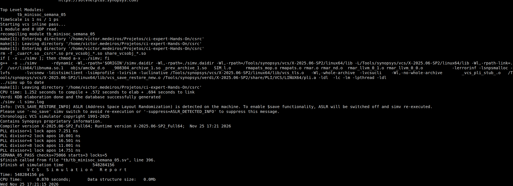

# Semana 5 — SPI front-end e PLL mock

## O que foi feito

Foram implementados o front-end SPI, o banco de registradores no domínio always-on e o modelo de PLL. Também foram preparados o testbench dirigido e a seleção de fontes no Makefile. A tabela relaciona os itens solicitados com a implementação e as verificações realizadas.

| Implementação / verificação | Ponto de entrega | Status |
| --- | --- | --- |
| [minisoc_spi](../../rtl/minisoc_spi/minisoc_spi.sv) recebe MOSI na subida e atualiza MISO na descida de `spi_sclk`, com os campos RWb, ADDR[5:0], RSV e DATA[31:0]. | SPI Mode 0, MSB-first e frame de 40 bits | ✅ |
| Escritas e leituras exercitadas via SPI, com seleção do endereço e retorno pelo NOP `0x3F`. | Escrita em uma transação e leitura em duas | ✅ |
| Recepção serial em `spi_sclk`, banco em `clk` always-on e transferência do frame completo por toggle com mailbox e confirmação. | Separação de clocks e CDC por toggle | ✅ |
| Implementados KEY0–KEY3, IV0–IV3, COUNTER_HI/LO, NUM_BLOCKS, AES_CONTROL, AES_STATUS, VERSION, SYSTEM_CONTROL e SYSTEM_STATUS. | Banco de registradores da seção 6 | ✅ |
| Escrita de 1 em AES_CONTROL gera um pulso de um ciclo; o testbench conferiu duração e configuração associada aos comandos. | START write-one-pulse | ✅ |
| [minisoc_pll_mock](../../rtl/minisoc_pll/minisoc_pll_mock.sv) recebe enable e PLL_DIV_SEL e fornece /1, /2, /4 e /8, como modelo de integração. | PLL mock com referência de 2 GHz e quatro divisores | ✅ |
| Implementada espera pseudoaleatória após enable; verificados bloqueio quando desabilitado, retirada de lock e reabilitação. O fechamento do clock aguarda uma borda de descida para preservar o pulso em andamento. | Aquisição de lock e bloqueio do clock | ✅ |
| O [testbench](../../tb/tb_minisoc_semana_05.sv) verificou os 13 registradores R/W e as tentativas de escrita nos três registradores somente de leitura. | Escrita/leitura dos R/W e proteção dos R | ✅ |
| Testados os quatro divisores, com consulta de SYSTEM_STATUS por SPI e verificação dos períodos de saída. | Habilitação do PLL e polling até PLL_LOCKED=1 | ✅ |
| Fontes e testbench disponíveis nos links acima; [registro de lint](semana_05/lint_recebido.txt) sem erros. | RTL, testbench e relatório de lint | ✅ |

## Resultados obtidos

A execução foi realizada sem erros no lint, com o resultado:

```text
SEMANA_05_PASS checks=75066 starts=3 locks=5
```

Foram registradas **75.066 verificações**, **3 comandos START** e **5 aquisições de lock**. A contagem de verificações inclui as observações repetidas dos monitores de clock. O tempo simulado foi de **548,284156 µs**.

| Divisor do PLL | Latência de lock exibida no teste |
| --- | --- |
| /1 | 7,251 ns |
| /2 | 10,001 ns |
| /4 | 16,501 ns |
| /8 | 11,001 ns |
| /1 — reabilitação | 14,751 ns |

Os testes de acesso aos registradores, START, recuperação após reset e funcionamento do PLL concluíram sem falhas. As latências da tabela são as impressas pelo monitor, incluindo sua espera de observação de 1 ps.

### Print da execução dos testes

O print fornecido mostra a elaboração, os locks nos quatro divisores, a reabilitação e o resultado final do testbench.



[Ampliar o print](semana_05/figures/execucao_2026-11-25.png) · [Consultar a transcrição dos resultados](semana_05/execucao_recebida.txt)

## Próximos passos — Semana 07

Implementar a memória compartilhada e o AES engine, com os modos ECB, CBC e CTR para cifra e decriptação, tratamento de configurações inválidas e testbench comparando os resultados com um modelo de referência em software.
