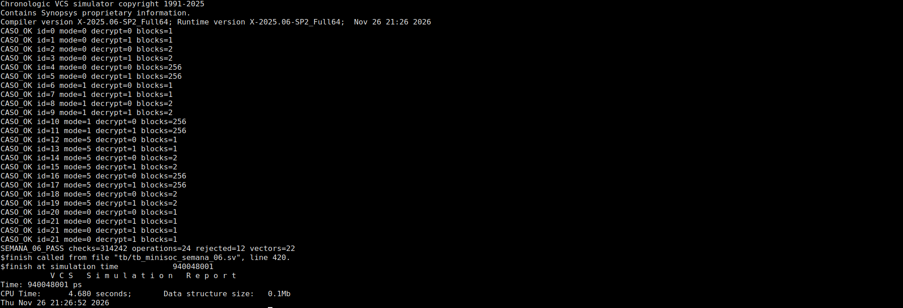

# Semana 6 — AES engine e memória compartilhada

## O que foi feito

Foram implementados a memória compartilhada e o AES engine, reutilizando o datapath e a expansão de chave das semanas anteriores. O conjunto processa ECB, CBC e CTR em cifra e decriptação, com escrita in-place e tratamento de configuração inválida.

| Implementação / verificação | Ponto de entrega | Status |
| --- | --- | --- |
| [minisoc_memory](../../rtl/minisoc_mem/minisoc_memory.sv) contém 1024 palavras de 32 bits, com um único porto síncrono e sem reset do conteúdo. | Memória da seção 7 | ✅ |
| Endereço, dado, write-enable e clock seguem o owner efetivo. A troca aguarda os dois clocks baixos e BUSY=0; o TB verificou a retenção durante processamento e a exclusão do mestre não selecionado. | Ownership solicitado por MEM_SEL_AES | ✅ |
| [minisoc_aes_top](../../rtl/minisoc_aes/minisoc_aes_top.sv) captura KEY, IV, COUNTER, MODE, DECRYPT e NUM_BLOCKS ao aceitar START válido. O TB altera os campos externos e emite outro START durante BUSY. | Snapshot da operação | ✅ |
| A FSM lê quatro palavras, processa o bloco e grava quatro palavras nos mesmos endereços. O readback confere também a região fora da operação. | Processamento multi-bloco in-place | ✅ |
| BUSY acompanha a operação; DONE permanece sticky; BLOCKS_DONE só avança após as quatro escritas e representa inclusive 256. | Status da operação | ✅ |
| ECB usa cifra/inversa; CBC preserva o ciphertext de entrada na decriptação; CTR usa AES encrypt sobre IV XOR contador zero-extendido nos dois sentidos. | Modos ECB, CBC e CTR | ✅ |
| NUM_BLOCKS é validado nos 32 bits antes de truncar. Quantidade inválida ou MODE reservado gera ERROR sem iniciar expansão/datapath ou modificar a memória. | Detecção de configuração inválida | ✅ |
| [Testbench de bloco](../../tb/tb_minisoc_semana_06.sv) compara os resultados com os [vetores](../../tb/vectors/semana_06/vectors.txt) produzidos pelo [modelo Python](../../scripts/gen_semana_06_vectors.py). | 1, 2 e 256 blocos por modo e direção | ✅ |

## Resultados

Teste executado com lint sem erros em **26/11/2026**, no VCS **X-2025.06-SP2_Full64**:

```text
SEMANA_06_PASS checks=314242 operations=24 rejected=12 vectors=22
```

| Indicador | Resultado |
| --- | --- |
| Verificações (`checks`) | 314.242 |
| Operações concluídas (`operations`) | 24 |
| Configurações rejeitadas (`rejected`) | 12 |
| Casos lidos do arquivo (`vectors`) | 22 |
| Tempo simulado | 940.048.001 ps = 940,048001 µs |
| Tempo de CPU da simulação informado pelo VCS | 4,680 s |
| Avisos de lint | 23 avisos `Lint-[NS]`, relativos às esperas intencionais de tempo/evento do TB |

`checks` inclui as verificações repetidas dos monitores, e não corresponde a 314.242 cenários distintos. `vectors=22` contabiliza casos de teste: cada um pode conter vários blocos. O TB chegou ao `$finish`, na linha 420, sem falha de comparação no percurso executado.

Foram exercitados os seguintes modos e quantidades:

| Modo | MODE | Cifra | Decriptação | Resultado |
| --- | --- | --- | --- | --- |
| ECB | 0 | 1, 2 e 256 blocos | 1, 2 e 256 blocos | IDs 0..5 com CASO_OK |
| CBC | 1 | 1, 2 e 256 blocos | 1, 2 e 256 blocos | IDs 6..11 com CASO_OK |
| CTR | 5 | 1, 2 e 256 blocos | 1, 2 e 256 blocos | IDs 12..17 com CASO_OK |
| CTR com overflow do contador | 5 | 2 blocos | 2 blocos | IDs 18..19 com CASO_OK |
| Exemplo FIPS em ECB | 0 | 1 bloco | 1 bloco | IDs 20..21 com CASO_OK |

As duas execuções adicionais do ID 21 verificam recuperação após ERROR e após reset durante escrita. Por isso, são **24 operações concluídas para 22 casos de vetores**. O aborto dirigido por reset não é contado como uma operação concluída.

As 12 rejeições correspondem a cinco quantidades inválidas (`0`, `257`, `512`, `0x00010001` e `0xffffffff`), cinco modos sem suporte nesta entrega (`2`, `3`, `4`, `6` e `7`) e duas novas rejeições após uma conclusão, para verificar a preservação de DONE/BLOCKS_DONE. O TB também verificou que essas rejeições preservam o conteúdo da memória e que um novo START válido limpa ERROR.

A conclusão do roteiro inclui os testes de snapshot, START durante BUSY, START sem ownership, contagem até 256, retenção de DONE, readback in-place, palavras sentinelas fora da região, memória preservada no reset e aborto após a primeira escrita. O reset mantém a palavra já gravada e não oferece rollback das alterações.



[Ampliar o print](semana_06/figures/execucao_2026-11-26.png) · [Registro da execução](semana_06/execucao_recebida.txt) · [Registro de lint](semana_06/lint_recebido.txt)

## Limitações conhecidas da v1.0 nesta entrega

**PCBC, CFB e OFB ficam para a semana 10.** Embora tenham códigos definidos no Block Guide, não são implementados nesta revisão e são rejeitados com ERROR. Essa limitação deve acompanhar a entrega ao verificador parceiro.

O CTR segue a regra do projeto: `AES encrypt(IV XOR zero_extend(counter))`, com incremento módulo 2^64 e sem writeback do contador no banco de configuração. START inválido preserva DONE/BLOCKS_DONE anteriores; reset aborta o controle sem apagar a memória.

A verificação foi de bloco, conectando engine e memória. A integração completa com SPI/PLL, os bridges de comando/status entre clocks e a implementação física da seleção de clock ficam para a etapa de integração. O resultado funcional não representa comprovação de CDC físico, frequência máxima, área ou potência.
